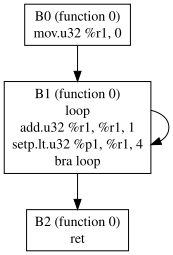

# PTX Analyzer

A C++17 command-line analyzer for NVIDIA PTX assembly. It parses multiple kernel/function bodies, divides instructions into basic blocks, builds a control-flow graph (CFG), emits Graphviz DOT, computes dominators and natural loops, performs register liveness analysis, estimates peak live-register pressure, and can remove unreachable blocks.

The repository includes PTX emitted by NVIDIA NVCC 12.9.1 through Compiler Explorer (`nvcc129u1`, `-arch=sm_70`) from four small CUDA kernels. The compiled source is `tests/real_kernels.cu`; the checked-in PTX is `tests/real_kernels.ptx`. The integration test parses all four kernels and checks their control-flow graphs and loops.

## Build and test on Windows

Open **Developer PowerShell for Visual Studio 2022**, then change directory to this project. The Visual Studio Installer workload **Desktop development with C++** must be installed.

Build and run the command-line tool:

```powershell
cl /std:c++17 /EHsc /W4 main.cpp analyzer.cpp /Fe:ptx-analyzer.exe
```

Compile and run the test program:

```powershell
cl /std:c++17 /EHsc /W4 /I. tests\test_analyzer.cpp analyzer.cpp /Fe:test-analyzer.exe
.\test-analyzer.exe
```

Run these commands from the project root so the test can open `tests\real_kernels.ptx`.

## Build and test on Linux or WSL

Install a C++17 compiler and GNU Make, then from the project root run:

```sh
make
make test
```

## Run the analyzer

```powershell
.\ptx-analyzer.exe tests\real_kernels.ptx --dominators --loops --liveness
.\ptx-analyzer.exe examples\unreachable.ptx --prune-unreachable --dot after.dot
```

On Linux/WSL, use `./ptx-analyzer` and forward slashes in paths. DOT is printed to standard output by default. With `--dot`, it is written to the given file. Analysis reports go to standard error.

Options:

- `--dominators` prints each block's dominator set.
- `--loops` lists back edges recognized as natural loops and their member blocks.
- `--liveness` prints block live-in/live-out sets and the estimated peak number of simultaneously live PTX virtual registers.
- `--prune-unreachable` removes blocks not reachable from any kernel/function entry and reports the before/after block and instruction counts.
- `--dot FILE` writes the CFG in Graphviz DOT format.

To render DOT as SVG with Graphviz installed:

```sh
dot -Tsvg after.dot -o after.svg
```

## Example

Input (`examples/loop.ptx`):

```ptx
mov.u32 %r1, 0;
loop:
  add.u32 %r1, %r1, 1;
  setp.lt.u32 %p1, %r1, 4;
  @%p1 bra loop;
  ret;
```

The analyzer forms three blocks: the initialization block, the loop block, and the return block. Its important CFG edges are:

```text
B0 -> B1
B1 -> B1
B1 -> B2
```

The self-edge is the repeated loop path; the edge to `B2` is the path that exits it. A rendered CFG is included below.



The checked-in four-kernel NVCC fixture currently parses into **19 basic blocks** and detects **3 natural-loop back edges**.

## Analyses

**Basic blocks and CFG.** Leaders are the first instruction of each function, labeled instructions, direct branch targets, and instructions following control-flow terminators. `bra` adds an edge to its target. A predicated branch also has a fallthrough edge. A predicated `ret`, `exit`, `kill`, or `trap` has a fallthrough edge for the path where its predicate is false. Fallthrough never crosses function boundaries.

**Dominators.** For each function, the entry block initially dominates itself. Other reachable blocks start with the set of reachable blocks in that function. The analyzer repeatedly intersects the dominator sets of a block's reachable predecessors and adds the block itself. It repeats until no set changes because one update can affect the answer for later blocks in the next iteration.

**Natural loops.** An edge `latch -> header` is a back edge when `header` dominates `latch`. Starting with the header and latch, the analyzer walks predecessor edges backward from the latch until it reaches the header. Each back edge is reported as a loop; loops with the same header but distinct latches are listed separately.

**Liveness and pressure.** The analyzer identifies register uses and definitions for common PTX instruction forms, then iterates the standard block equations to a fixed point:

```text
OUT[B] = union of IN[successor]
IN[B]  = USE[B] union (OUT[B] - DEF[B])
```

It walks each block's instructions backward to estimate peak pressure as the largest number of simultaneously live PTX virtual registers. Built-in special registers such as `%tid.x` are excluded. This is a static estimate, not hardware occupancy: it does not model allocation, register classes, spilling, or architecture-specific constraints.

**Unreachable-block removal.** Reachability starts from every function entry, so kernels in one PTX file are analyzed independently. The optional optimization drops blocks that cannot be reached from any entry and reports counts before and after. It does not rewrite or renumber instruction operands.

For `examples/unreachable.ptx`, the checked run reported **2 blocks and 4 instructions before**, then **1 block and 2 instructions after** removal. The reachable entry and return remain; the dead labeled block is removed from the CFG.

## Tests

`tests/test_analyzer.cpp` covers parsing, block boundaries, conditional edges, dominators, self-loops, multi-block loops with an internal branch, nested loops, a no-loop function, predicated returns, liveness equations, pressure estimation, unknown branch labels, unreachable-block removal, and integration against the four-kernel NVCC PTX fixture.

## Current limitations

- This is a PTX analyzer, not a complete PTX parser or CUDA compiler.
- It supports direct named `bra` targets; indirect branches and other dynamic control-flow mechanisms are outside the current scope.
- Register use/definition classification covers common instruction forms. Complex instructions with multiple optional destinations or unusual operand syntax may need more precise rules.
- Natural-loop discovery uses dominator back edges and reports one loop per back edge; irreducible control flow is not decomposed into a full loop forest.
- Register pressure counts live virtual register names as a single class. It is not the final physical register count reported by `ptxas`.
- The checked-in NVCC fixtures provide real compiler output coverage, but four kernels do not establish support for every PTX version or instruction family.
