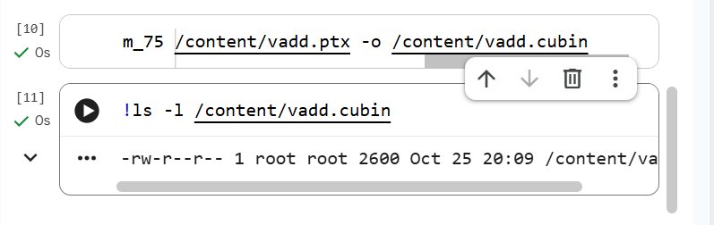
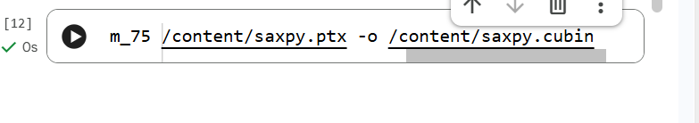
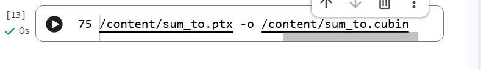

# Project 2: Tiny GPU Language to PTX Compiler

`ptxc` is a C++17 compiler for a small C-like GPU language. It translates `.k` source files into NVIDIA PTX. The compiler is intentionally small enough to follow from lexer to output, while still supporting kernels, pointers, arrays, control flow, types, and multiple kernels per file.

```text
.k source -> lexer -> recursive-descent parser -> AST -> semantic checker -> PTX generator -> .ptx
```

## What it supports

- Types: `int`, `float`, `int*`, and `float*` (pointers refer to global memory).
- Local declarations, assignments, indexed loads and stores.
- `+`, `-`, `*`, `/`, unary minus, comparisons, and `&&` / `||` between comparisons.
- `if`, `if/else`, `while`, `for`, and nested blocks.
- `gid()` for the 1D global thread index; `tid()` for the x thread index within a block.
- Multiple kernel definitions in one file and `//` comments.

It intentionally does not support ordinary functions, structs, implicit type conversions, shared memory, or multidimensional indexing.

## Project layout

- `src/lexer.cpp` turns characters into tokens and keeps line/column positions.
- `src/parser.cpp` implements recursive descent and builds the AST declared in `src/ast.hpp`.
- `src/sema.cpp` checks scopes, declarations, pointer indexing, types, and comparison conditions.
- `src/codegen.cpp` turns the checked AST into PTX virtual registers, labels, parameter loads, and global-memory operations.
- `src/main.cpp` implements the `ptxc` command-line interface.
- `tests/` contains phase tests, command-line tests, and valid/invalid sample programs.
- `examples/` contains `vadd`, `saxpy`, `sum_to`, and `for_logical` source files and generated PTX files.
- `docs/` contains Colab screenshots showing successful `ptxas` runs.

## Build and tests on Windows

Install the Visual Studio workload **Desktop development with C++**, open **Developer PowerShell for Visual Studio 2022**, and change to the `Project2` folder. Build the compiler:

```powershell
cl /std:c++17 /EHsc /W4 /Isrc src\ast.cpp src\lexer.cpp src\parser.cpp src\sema.cpp src\codegen.cpp src\main.cpp /Fe:ptxc.exe
```

Build and run the C++ phase tests, then run the CLI tests. Python 3 is used by the CLI test runner:

```powershell
cl /std:c++17 /EHsc /W4 /Isrc src\ast.cpp src\lexer.cpp src\parser.cpp src\sema.cpp src\codegen.cpp tests\test_compiler.cpp /Fe:test-compiler.exe
.\test-compiler.exe
python tests\run_tests.py .\ptxc.exe
```

If NVIDIA `ptxas` is installed, pass its path to assemble every successful CLI fixture too:

```powershell
python tests\run_tests.py .\ptxc.exe --ptxas "C:\path\to\ptxas.exe"
```

Run commands from this folder so the test runner can locate the sample files.

## Build and tests on Linux or WSL

Install a C++17 compiler, GNU Make, and Python 3. From the `Project2` folder run:

```sh
make
make test
```

## Compile a kernel

```powershell
.\ptxc.exe examples\vadd.k -o examples\vadd.ptx
.\ptxc.exe examples\sum_to.k -o examples\sum_to.ptx --dump-ast
.\ptxc.exe examples\for_logical.k -o examples\for_logical.ptx
```

`--dump-ast` prints the typed syntax tree to the terminal. PTX is written to the path after `-o`.

## Language grammar

The grammar below describes the supported core. A `for` loop uses an optional initializer, condition, and step; when present, its condition must be a comparison expression. Omitting the condition creates an infinite loop.

```ebnf
program      = kernel, { kernel } ;
kernel       = "kernel", identifier, "(", [ parameters ], ")", block ;
parameters   = parameter, { ",", parameter } ;
parameter    = type, identifier ;
type         = ("int" | "float"), [ "*" ] ;
declaration-or-assignment = type, identifier, [ "=", expression ] | assignment ;
assignment   = identifier, [ "[", expression, "]" ], "=", expression ;
block        = "{", { statement }, "}" ;
statement    = block
             | type, identifier, [ "=", expression ], ";"
             | assignment, ";"
             | "if", "(", expression, ")", statement, [ "else", statement ]
             | "while", "(", expression, ")", statement
             | "for", "(", [ declaration-or-assignment ], ";",
               [ expression ], ";", [ assignment ], ")", statement ;
expression   = logical-or ;
logical-or   = logical-and, { "||", logical-and } ;
logical-and  = comparison, { "&&", comparison } ;
comparison   = additive, [ ("<" | "<=" | ">" | ">=" | "==" | "!="), additive ] ;
additive     = term, { ("+" | "-"), term } ;
term         = unary, { ("*" | "/"), unary } ;
unary        = "-", unary | primary ;
primary      = integer | float | identifier | identifier, "[", expression, "]"
             | "gid", "(" , ")" | "tid", "(" , ")"
             | "(", expression, ")" ;
```

Logical operators require comparison expressions on both sides and short-circuit: the right-hand comparison is only evaluated when needed. The language does not permit assignment or other side effects inside expressions.

## Source-to-PTX translation guide

| Source construct | Typical PTX emitted | What it does |
| --- | --- | --- |
| Scalar kernel parameter | `.param` and `ld.param` | Reads the argument passed to the kernel. |
| Pointer parameter | `ld.param.u64`, `cvta.to.global.u64` | Loads a 64-bit pointer and marks it as a global address. |
| `gid()` | `mov` of `%ctaid.x`, `%ntid.x`, `%tid.x`; `mad.lo.s32` | Computes block index × block size + thread index. |
| `tid()` | `mov.u32 ..., %tid.x` | Reads the thread's x index within its block. |
| `p[i]` / `p[i] = value` | `mul.wide.s32`, `add.s64`, `ld.global` / `st.global` | Scales the index by four bytes, forms an address, then loads or stores. |
| Arithmetic | `add`, `sub`, `mul.lo` / `mul`, `div` | Performs integer or floating-point arithmetic. |
| Comparison | `setp.lt`, `setp.eq`, etc. | Produces a predicate register. |
| `&&` / `||` | Predicate-controlled branches and `mov.pred` | Combines comparisons with short-circuit behavior. |
| `if`, `while`, `for` | Predicate-controlled `bra` plus labels | Selects a path or repeats a loop. |

Example input (`examples/vadd.k`):

```c
kernel vadd(float* a, float* b, float* out, int n) {
    int i = gid();
    if (i < n) {
        out[i] = a[i] + b[i];
    }
}
```

The generated file begins with a PTX header and kernel parameter declarations. The body loads pointer parameters, converts them to global addresses, computes a global thread index, checks the bound, loads two floats, adds them, and stores the result:

```ptx
.version 7.8
.target sm_75
.address_size 64
.visible .entry vadd(
    .param .u64 vadd_param_0,
    ...
)
{
    ...
    mad.lo.s32 %r6, %r3, %r4, %r5;
    setp.lt.s32 %p1, %r2, %r1;
    @!%p1 bra L_end1;
    ...
    add.f32 %f3, %f1, %f2;
    st.global.f32 [%rd12], %f3;
L_end1:
    ret;
}
```

The exact register numbers depend on how many temporaries the kernel uses. Full generated examples are checked in as `examples/vadd.ptx`, `examples/saxpy.ptx`, and `examples/sum_to.ptx`.

## Validation and Project 1 connection

The automated suite checks lexer tokens, expression precedence, AST output, emitted PTX patterns, source-line diagnostics, required semantic errors, `for` / logical operators, and multiple kernels. Its command-line fixtures include ten valid programs and nine programs that must be rejected.

The generated `sum_to.ptx` was also read by Project 1's analyzer. It produced a six-block CFG and found the loop back edge from the loop body to `L_cond1` (reported as `B3 -> B2`). The resulting DOT file is checked in as `examples/sum_to_cfg.dot`. To repeat this on Windows from this folder, build Project 1 first, then run:

```powershell
..\ptx-analyzer.exe examples\sum_to.ptx --dominators --loops
```

The `vadd.ptx`, `saxpy.ptx`, and `sum_to.ptx` examples were assembled successfully with NVIDIA `ptxas` for `sm_75` in Google Colab. The full CLI suite generated ten valid PTX files, and `ptxas` assembled all ten. The `vadd.ptx` kernel was also loaded and run on a Colab Tesla T4: all 1,024 output values matched the expected sums. The GPU check uses `tests/run_vadd_colab.py`. To validate every valid CLI test fixture (including `for_logical.k`) on a machine with `ptxas`, pass its path to the test runner as shown above. For an individual file, run:

```sh
ptxas -arch=sm_75 examples/vadd.ptx -o vadd.cubin
```

Only call a file PTX-validated after `ptxas` completes successfully.

Colab screenshots for the three example assemblies:

**`vadd.ptx`**



**`saxpy.ptx`**



**`sum_to.ptx`**



See [the hand trace of `sum_to.ptx`](docs/sum-to-ptx-trace.md) for a line-by-line explanation of the generated instructions.

### Run the complete validation in Colab

Upload `Project2-colab.zip` from the project folder to a Colab notebook using the Files panel's upload button. Then run these cells in order. The first unpacks the project and builds/runs its regular tests; the next runs `ptxas` on every successful CLI fixture; the last loads the generated PTX with NVIDIA's `cuda-python` Driver API, launches `vadd` for 1,024 values on the GPU, and checks every output against the expected sum.

```python
!unzip -qo /content/Project2-colab.zip -d /content/Project2
%cd /content/Project2
!make test
!python tests/run_tests.py ./ptxc --ptxas /usr/local/lib/python3.13/dist-packages/nvidia/cuda_nvcc/bin/ptxas
!pip -q install cuda-python numpy
!python tests/run_vadd_colab.py
```

The `ptxas` test-runner command assembles all ten valid CLI fixture outputs. The last script prints `PASS` only after all 1,024 GPU results match. Use a Colab GPU runtime for the final step. If Colab's Python version differs, update the `python3.13` segment of the `ptxas` path to match the path shown by `find /usr/local -name ptxas -type f`.

## Compiler phases and design

### Lexer

The lexer recognizes keywords, names, integer and float literals, operators, and punctuation. It skips whitespace and `//` comments. Errors include the source line and column.

### Parser and AST

The parser follows the grammar's precedence levels: logical OR, logical AND, comparison, additive, multiplication/division, unary minus, and primary expressions. As a result, `a + b * c` becomes `a + (b * c)`. `--dump-ast` prints the tree after type checking.

### Semantic checker

A stack of symbol-table scopes tracks variables and their types, including the scope introduced by a `for` initializer. The checker rejects undeclared names, duplicate declarations in one scope, indexing non-pointers, mixed or incompatible types, and conditions that are not comparisons. It does not insert implicit casts.

### PTX generator

Each source variable and temporary is assigned a PTX virtual register. Integers use `%r`, floats `%f`, addresses `%rd`, and predicates `%p`. The generator declares the register ranges it used at the start of each kernel; physical register allocation is left to NVIDIA's later toolchain.

A pointer parameter is loaded from `.param` memory and converted with `cvta.to.global`. Indexing multiplies the signed 32-bit index by four using `mul.wide.s32`, adds that byte offset to a 64-bit pointer, then emits `ld.global` or `st.global`. `gid()` computes `ctaid.x * ntid.x + tid.x`. Floating-point constants are encoded as their 32-bit IEEE-754 bit pattern in PTX hexadecimal notation.

Comparisons become `setp` predicate instructions; `&&` and `||` use branches to preserve short-circuit behavior and `mov.pred` to return a predicate. `if`, `while`, and `for` control flow becomes labels and predicated branches. A `while` or `for` loop branches back to its condition label; Project 1 recognizes this as a natural-loop back edge.

## Current limitations

- This is a small educational compiler, not a complete C/C++ or CUDA implementation.
- Pointers are treated as 64-bit global-memory addresses; pointer arithmetic other than array indexing is not supported.
- Only 1D `gid()` and `tid()` are implemented, and indices use a four-byte element size.
- There are no bounds checks except those explicitly written in the source.
- No optimization or definite-assignment analysis is performed. Reading a local variable before assigning it may produce undefined runtime behavior.
- Integer division and floating-point behavior use direct PTX operations; detailed C/CUDA overflow, rounding, and exceptional-value semantics are not modeled.
- `&&` and `||` accept comparison operands only. Expressions do not support assignment or function calls with side effects.
- The three example PTX files have passed `ptxas`; other generated test fixtures need the optional `--ptxas` test-runner check before claiming they assemble.
